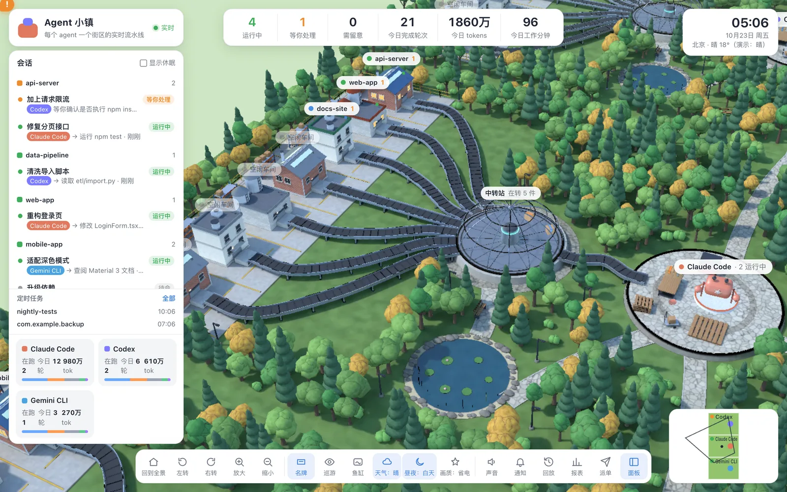
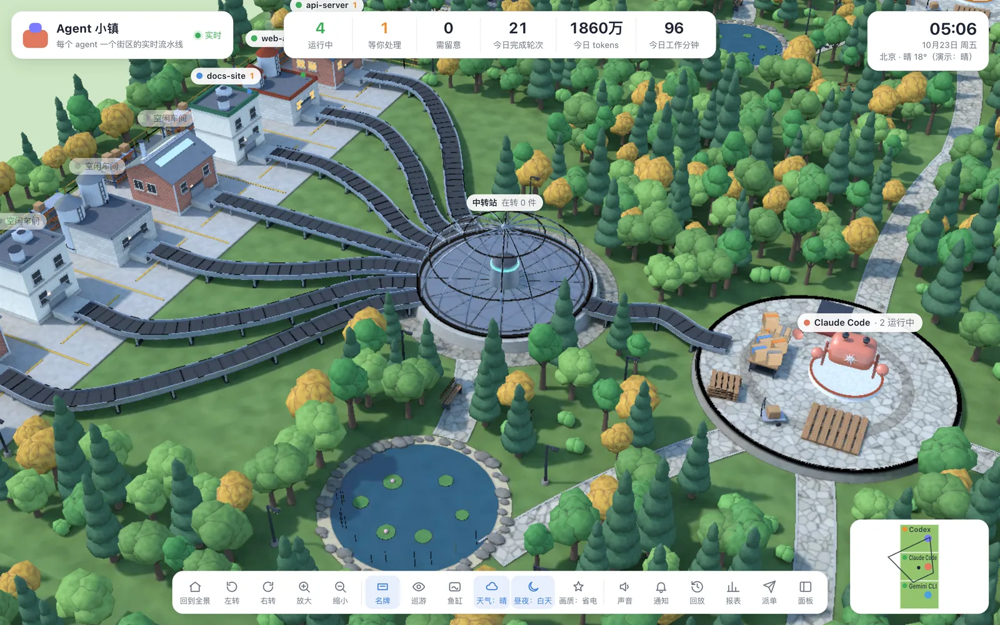
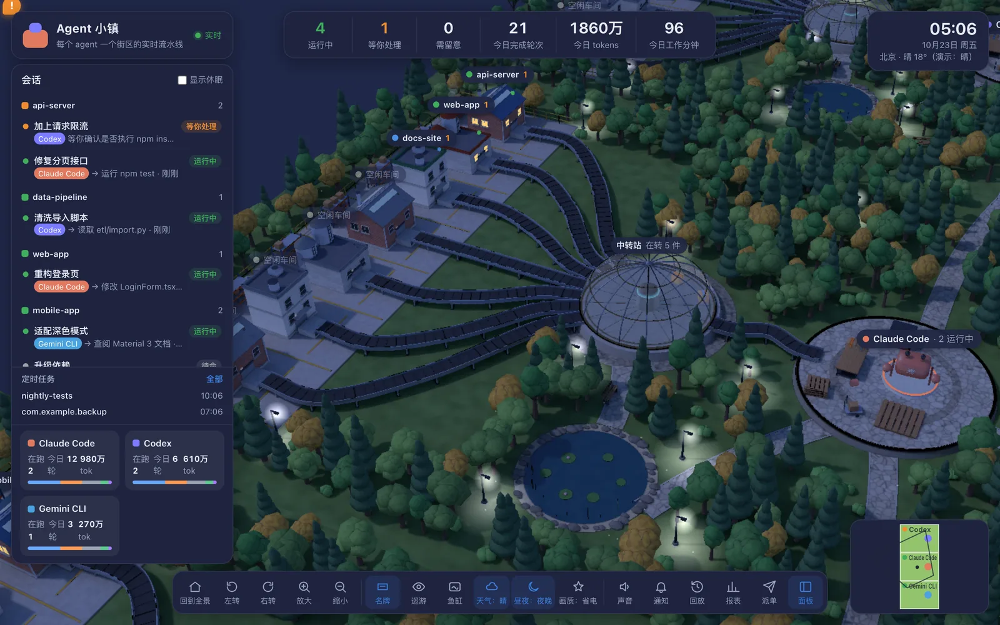

# Agent 小镇

**把你电脑上 AI 编程 agent 的实时工作，画成一座 3D 微缩小镇。**

每个 agent 一个街区，每个项目一间车间，每次工具调用是一件包裹：从车间出发，沿传送带经过中转站，送到 agent 所在的广场，干完一轮就打包发货。谁在干活、谁在等你确认、谁卡住了，扫一眼就知道。

内置 Claude Code 和 Codex，其他 agent 用一个 HTTP 接口推事件就能接入。纯本地运行，只读本机日志，不上传任何内容（只有天气会联网查询）。

<p align="center"></p>

<table>
  <tr>
    <td width="50%"></td>
    <td width="50%"></td>
  </tr>
</table>

> 截图里的项目和会话都是演示数据。

## 快速开始

需要 Node 20+。

```bash
git clone https://github.com/yuyongyan29-dev/agent-town.git
cd agent-town
npm install
npm start
```

打开 http://localhost:4317 。端口可以用 `PORT=xxxx npm start` 修改。

开箱即用，不需要配置：小镇会实时读取这些日志。

| agent | 日志位置 |
|---|---|
| Claude Code | `~/.claude/projects/**/*.jsonl` |
| Codex | `~/.codex/sessions/**/*.jsonl` |

可选：装上 hook 之后，「等你授权」「回合结束」这类状态会更及时。

```bash
npm run hooks:install    # 卸载：npm run hooks:uninstall
```

它会把 hook 合并进 `~/.claude/settings.json` 和 `~/.codex/hooks.json`，保留已有配置，改之前先备份成 `*.agent-town.bak`。小镇没开时 hook 会静默跳过，不影响 agent。

## 小镇里能看到什么

- **车间**：每个 agent 最近活跃的 7 个项目各占一间。屋顶信标表示状态（运行中 / 等你处理 / 需留意 / 刚完成），冒烟表示正在干活，亮灯表示有会话在跑。
- **包裹**：一次工具调用。胶带颜色表示类别：读取、修改、命令、联网、子代理、其他。出错的包裹会变红，掉进次品箱。
- **中转站和广场**：工具调用结束后，包裹送到 agent 的工作台，再码到托盘上，攒满一托就发货。
- **角色**：Claude Code 是小螃蟹，Codex 是小云朵，其他 agent 是主题色的小机器人。在等你处理时头上冒出感叹号，休眠时打瞌睡，干完一轮会撒彩纸。
- **天气和昼夜**：昼夜按本机时间。天气默认取北京实况，可以用环境变量 `AT_CITY` / `AT_LAT` / `AT_LON` 换成你所在的城市。两者都能在工具栏手动切换。
- **无限画布**：每多一个 agent，就自动在空地上开一个新街区；街区之间的空格子铺成树林。按住 Shift 拖动街区可以挪位置，右下角小地图显示全部街区和当前视野。

## 功能

- **会话列表**：按项目分组，显示正在调用的工具、等待原因和卡住提示。可以给会话改名，也可以一键复制 `claude --resume` / `codex resume` 恢复命令。
- **提醒**：agent 等你授权、干完了、可能卡住时弹出提示；可以开声音和系统通知，标签页标题上会显示待处理数。
- **详情**：模型、权限模式、当前工具、最近错误、各工具耗时统计、时间线。
- **报表**：近 7 天或 30 天的轮次、工具调用、tokens 和工作分钟，按天、按项目、按 agent 统计。
- **定时任务**：读取本机的 crontab 和 launchd 用户任务。
- **派单**：在指定项目目录里，直接让 Claude Code 或 Codex 非交互地跑一条任务。
- **回放**：以 10 / 30 / 60 倍速重放最近 1 小时。
- **镜头**：左键平移、右键旋转、滚轮朝光标缩放。另有全景、巡游、鱼缸模式（隐藏面板缓慢旋转，适合挂在副屏上）。

## 接入其他 agent

任何能发 HTTP 请求的程序，都可以把事件推到 `POST /api/ingest`（只接受本机请求）。agent 名用小写字母、数字和 `_.-`，第一次出现时会自动开出一个新街区：

```bash
curl -X POST http://localhost:4317/api/ingest -H 'Content-Type: application/json' -d '{
  "agent": "gemini", "name": "Gemini CLI", "color": "#4aa3df",
  "events": [
    { "sid": "s1", "kind": "turnStart", "cwd": "/path/to/project", "prompt": "跑测试" },
    { "sid": "s1", "kind": "toolStart", "toolId": "t1", "tool": "Bash", "label": "npm test" },
    { "sid": "s1", "kind": "toolEnd", "toolId": "t1" },
    { "sid": "s1", "kind": "turnEnd" }
  ]
}'
```

请求体也可以是单个事件，或者每个事件自带 `agent` 字段的事件数组。`kind` 常用 `turnStart`、`toolStart`、`toolEnd`（可带 `isError`）、`wait`、`turnEnd`、`sessionEnd`。`color` 不填时会按名字自动生成一个颜色。

支持 hook 的 agent，也可以直接把 hook 的标准输入转给小镇：在它的 hook 配置里调用 `node scripts/hook.js <agent 名>`，事件格式与 Claude Code hooks 相同。

## 画面是怎么做的

模型由 Blender 程序化生成（`tools/bake_town.py`）：砖墙厂房、彩钢瓦屋顶、橡胶传送带、钢板转盘、铺路石、池塘和树林。用 Cycles 把光照、阴影和角落的暗部烘焙进贴图，导出成 `public/assets/*.glb`，布局坐标一起导出到 `public/assets/town.json`。

网页用 three.js 显示，所有模型都只贴烘焙好的图，不做实时光照和阴影。阴天、夜晚在贴图上整体调色，路灯和亮着的窗户单独发光。车间屋顶的漆色、包裹胶带的颜色、机器人的主题色都烘焙成浅色，在网页里再上色。

素材已经放在仓库里，运行时不需要 Blender。只有改了模型或布局时，才需要重新出图（要先装 [Blender](https://www.blender.org/)，`package.json` 里写的是 macOS 的安装路径，其他系统请改成本机路径；加 `-- --quick` 是低分辨率快速档）：

```bash
npm run assets
```

## 性能

小镇设计成可以一直挂着不占资源：

- **按需渲染**：画面没有变化时一帧都不画；agent 在干活时约 12 帧/秒，有包裹在路上时 30 帧/秒，操作镜头时才满帧。
- **光影全部烘焙**：网页里没有实时光照、阴影和后期特效，GPU 只做最基本的贴图绘制。
- **清晰度**：默认按 1 倍清晰度渲染，高分屏上不开多重采样抗锯齿；工具栏「画质：高」改为 2 倍清晰度。掉帧时会自动降低清晰度。
- **素材**：一共约 4MB；两个街区同屏时，每帧约 100 次绘制调用、40 多万个三角形。

## 目录

```
server/   日志解析、状态机、实时推送（SSE）、报表、定时任务、派单
scripts/  hook 脚本与 hook 安装脚本
tools/    Blender 建模与烘焙脚本
public/   网页；assets/ 是烘焙好的模型；js/ 下：
          world（加载模型、街区、天气昼夜）  agents（角色）  parcels（包裹）
          hud（面板）  main（入口、镜头、渲染调度、小地图）
docs/     README 用的截图
```

所有时间按本机时区显示和统计。

## 许可

[MIT](LICENSE)。第三方声明见 [THIRD_PARTY_NOTICES.md](THIRD_PARTY_NOTICES.md)。

---

**English summary** — Agent Town turns the live activity of your local AI coding agents (Claude Code, Codex, or anything that can POST events) into a 3D miniature town. Each agent gets a district, each project a workshop, each tool call a parcel riding the conveyor belts. Models are procedurally built and light-baked in Blender, so the browser only draws pre-lit textures and renders on demand. Runs locally with `npm install && npm start`, reads local logs only.
